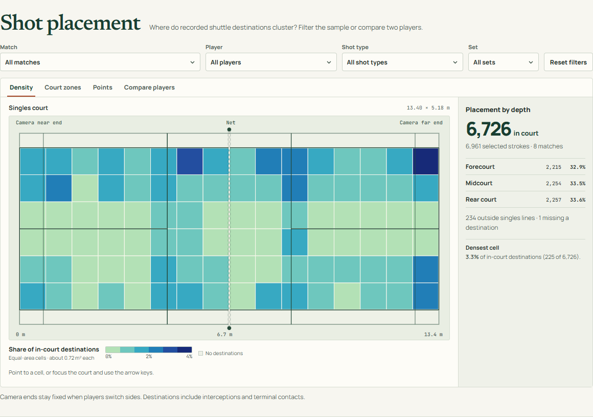

# Rally Atlas

Interactive badminton analytics using the [ShuttleSet](https://github.com/wywyWang/CoachAI-Projects/tree/main/ShuttleSet) dataset. Built as a group project for a Data Visualization course at Telkom University and AQX Sports Analytics Data Bowl 4.0.



## What it does

- **Shot placement:** Explore where recorded shots go using a court heatmap and player comparison.
- **Rally replay:** Step through recorded shots from selected matches.
- **Shot patterns:** Compare shot types, rally lengths, sequences and rally outcomes.
- **Scouting notes:** See patterns worth examining in match preparation.

The app covers **8 selected matches, 713 replayable rallies and 6,961 classified strokes**. These results describe the selected matches, not professional badminton as a whole.

## Run locally

Node.js 24 and npm are recommended.

```bash
npm ci
npm run dev
```

To run the checks:

```bash
npm run lint
npm run typecheck
npm test
npm run build
```

## Tech and data

React, TypeScript, Vite, D3, visx and Radix UI. Data processing uses Python. The processed data is included, so the app runs without API keys or a database.

See [data sources and methods](DATA_SOURCES.md) and the [project description](PROJECT_DESCRIPTION.md). The dataset comes from [ShuttleSet](https://arxiv.org/abs/2306.04948), with separate license and attribution notes under `public/data/`.

**Rally Atlas Team**, Telkom University.
